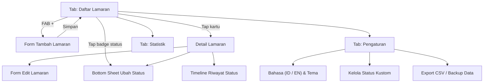

# PRD: Job Tracker Mobile App (MVP)

| Item | Detail |
|---|---|
| **Nama Produk (sementara)** | JobTrack |
| **Platform** | Android (Fokus APK Pribadi) & iOS (React Native + Expo) |
| **Versi Dokumen** | v1.1 (Updated sesuai keputusan MVP) |
| **Tanggal** | 9 November 2026 |
| **Referensi** | jobmetry.app (fiturnya dikurangi sampai versi MVP) |

---

## 1. Ringkasan

JobTrack adalah aplikasi mobile untuk **mencatat dan memantau lamaran kerja**. Aplikasi ini menggantikan spreadsheet Excel/Google Sheets yang biasa dipakai pencari kerja. Pengguna bisa mencatat lamaran dengan cepat (perusahaan, posisi, sumber lowongan, status, tanggal, gaji), melihat progresnya, dan mendapat ringkasan statistik sederhana langsung dari HP.

## 2. Latar Belakang & Masalah

Pencari kerja biasanya melamar ke puluhan bahkan ratusan lowongan di banyak platform (LinkedIn, Jobstreet, Glints, dll). Masalah yang sering muncul:

- **Excel tidak nyaman dipakai di HP**: kolomnya kecil, susah diedit, dan susah difilter.
- **Lupa sudah melamar ke mana**: akhirnya melamar dua kali ke tempat yang sama, atau lupa follow-up.
- **Status tidak rapi**: tidak jelas lamaran mana yang masih jalan, mana yang ditolak, dan mana yang di-ghosting.
- **Tidak tahu sumber mana yang paling efektif**: misalnya apakah LinkedIn lebih sering membalas daripada Jobstreet.
- **Info gaji tercecer**: ekspektasi gaji yang diajukan dan gaji yang ditawarkan tidak tercatat.

## 3. Tujuan & Non-Goals

### Tujuan (Goals)
1. Pengguna bisa menambah lamaran baru dalam **kurang dari 30 detik**.
2. Pengguna bisa melihat **semua lamaran beserta statusnya** dalam satu layar.
3. Pengguna bisa **memperbarui status** lamaran dengan cepat (termasuk menambah **status kustom** sendiri), dan riwayat perubahannya tersimpan.
4. Pengguna mendapat **statistik dasar** (total lamaran, response rate, sebaran per status dan per sumber).
5. Aplikasi berjalan **100% offline (lokal di HP)** dan mendukung **2 bahasa (Indonesia & Inggris)**.
6. Output build berupa **file APK** yang siap di-install untuk pemakaian pribadi.

### Bukan Tujuan (Non-Goals) untuk MVP
- Login/akun dan sinkronisasi cloud antar perangkat
- Publikasi ke Google Play Store / Apple App Store (fokus APK pribadi dulu)
- Fitur AI (analisis CV, cover letter generator, dll)
- Scraping atau impor otomatis dari LinkedIn/job portal
- Tampilan Kanban board drag & drop
- Integrasi kalender/email
- Versi web

## 4. Target Pengguna

| Persona | Deskripsi | Kebutuhan Utama |
|---|---|---|
| **Pemakaian Pribadi / Pencari Kerja Aktif** | Melamar di berbagai platform kerja secara rutin | Pencatatan cepat dari HP, kustomisasi status sesuai alur rekrutmen, dan backup data mudah |
| **Fresh Graduate** | Baru lulus, melamar ke banyak tempat sekaligus | Pencatatan cepat dan tidak lupa sudah melamar ke mana |
| **Job Switcher** | Sudah bekerja, mencari pekerjaan baru | Melacak tahapan interview dan membandingkan tawaran gaji |

## 5. Ruang Lingkup Fitur MVP

Prioritas: **P0** = wajib ada saat rilis MVP, **P1** = sebaiknya ada (menyusul setelah fitur inti selesai).

### 5.1 Manajemen Lamaran (CRUD): P0
- Tambah, lihat detail, edit, dan hapus lamaran
- Form dibagi menjadi **field wajib** (cepat diisi) dan **field opsional** (bisa dibuka/collapse)
- Konfirmasi sebelum menghapus

### 5.2 Daftar Lamaran (List): P0
- Kartu ringkas berisi: nama perusahaan, posisi, badge status (berwarna), sumber, dan tanggal melamar
- **Search** berdasarkan nama perusahaan atau posisi
- **Filter** berdasarkan status, sumber, dan tipe kerja
- **Sort** berdasarkan tanggal terbaru/terlama, nama perusahaan, dan terakhir diperbarui
- Tab cepat: **Semua | Aktif | Selesai**
  - *Aktif* = Status kategori aktif (Applied s/d Offering + status kustom kategori Aktif)
  - *Selesai* = Status kategori selesai (Accepted, Rejected, Ghosted, Withdrawn + status kustom kategori Selesai)
- Empty state yang mengajak pengguna menambah lamaran pertama

### 5.3 Update Status Cepat & Kustomisasi Status: P0
- Dari kartu atau detail, tap badge status untuk membuka bottom sheet pilihan status
- Setiap perubahan status otomatis dicatat ke **riwayat (timeline)** beserta tanggalnya
- **Manajemen Status Kustom**:
  - Tersedia status bawaan (default), namun pengguna bisa **menambah, mengubah nama/warna, atau menghapus status kustom** (misal: *"MCU / Medical Checkup"*, *"Background Check"*, *"Interview HR"*, *"Interview User"*).
  - Setiap status kustom dikelompokkan ke kategori **Aktif** atau **Selesai** agar perhitungan tab dan statistik tetap akurat.

### 5.4 Dashboard / Statistik Sederhana: P0
- Total lamaran
- Jumlah per status (kartu angka & bar chart sederhana)
- **Response rate** = lamaran yang sudah melewati tahap "Applied" ÷ total lamaran yang dikirim
- Jumlah per **sumber** (LinkedIn, Jobstreet, dll)
- Lamaran minggu ini / bulan ini

### 5.5 Pengaturan & Dual Bahasa (ID / EN): P0
- **Pilihan Bahasa**: Bahasa Indonesia (ID) & English (EN) secara instan tanpa restart app
- **Manajemen Status Kustom**: tambah/edit/urutkan status lamaran
- Mata uang default (`IDR`, `USD`, dll)
- Tema terang/gelap (Light / Dark / System)
- Hapus semua data

### 5.6 Export & Backup Data: P1
- Export semua lamaran ke **CSV** sehingga bisa dibuka di Excel / Google Sheets
- Export/Import backup database lokal (format **JSON**) supaya aman saat ganti HP meskipun belum pakai cloud sync
- Dibagikan lewat share sheet bawaan HP (Drive, WhatsApp, Email)

### 5.7 Pengingat Follow-up: P1
- Field opsional "Tanggal follow-up" pada lamaran
- Notifikasi lokal (`expo-notifications`) di tanggal tersebut
- Penanda otomatis "Belum ada kabar" untuk lamaran yang sudah lebih dari X hari di status *Applied* (default 14 hari)

---

## 6. Perbandingan Arsitektur Penyimpanan: Lokal vs Login + Cloud Sync

Sesuai keputusan MVP, aplikasi akan menggunakan **Penyimpanan Lokal (SQLite)** terlebih dahulu. Berikut pertimbangan plus-minusnya:

### A. Penyimpanan Lokal Saja (Dipilih untuk MVP)
| Kelebihan (Plus) | Kekurangan (Minus) |
|---|---|
| **Development jauh lebih cepat**: Tidak perlu buat halaman Login/Register, lupa password, manajemen session/token, dan konfigurasi backend. | **Risiko hilang jika HP rusak/hilang/uninstalled**: Data hanya ada di memori HP (bisa diakali dengan fitur Export CSV/JSON ke Google Drive). |
| **100% Offline & Sangat Cepat**: Buka aplikasi, tambah data, dan filter langsung instan tanpa loading internet. | **Tidak bisa multi-device otomatis**: Tidak bisa langsung buka data yang sama di HP lain atau di laptop/web. |
| **Biaya Server Rp 0**: Tidak perlu bayar atau memikirkan limit kuota database cloud (Supabase/Firebase). | |
| **Privasi Penuh**: Data gaji dan riwayat melamar tidak keluar dari perangkat pengguna. | |

### B. Login + Cloud Sync (Misal: Supabase / Firebase)
| Kelebihan (Plus) | Kekurangan (Minus) |
|---|---|
| **Data Aman di Cloud**: Ganti HP atau aplikasi terhapus tidak masalah, tinggal login kembali. | **Kompleksitas tinggi jika ingin tetap nyaman saat offline**: Harus menangani *offline-first sync* dan *conflict resolution* (misal edit saat tidak ada sinyal lalu sinkronisasi saat online). |
| **Bisa Multi-Device / Web**: Ke depannya sangat mudah jika ingin membuat versi website seperti `jobmetry.app` yang terhubung ke data yang sama. | **Waktu pengerjaan bertambah 1–2 minggu**: Harus mengurus Auth (Google Sign-In/Email), keamanan Row-Level Security (RLS), dan penanganan error jaringan. |

> **Strategi Transisi Terbaik**: Dengan memakai `expo-sqlite` + UUID sebagai ID di versi lokal, struktur tabel kita sudah 100% siap jika nanti di v2.0 ingin disambungkan ke **Supabase (PostgreSQL)**. Sementara itu, fitur **Export CSV/JSON** sudah cukup untuk mem-backup data pribadi.

---

## 7. Data Model

### 7.1 Entitas `Application` (Lamaran)

| Field | Tipe | Wajib | Keterangan |
|---|---|---|---|
| `id` | string (UUID) | ✅ | Otomatis |
| `companyName` | string | ✅ | Nama perusahaan |
| `position` | string | ✅ | Posisi yang dilamar |
| `source` | string | ✅ | Sumber info lowongan (lihat 7.2) |
| `sourceOther` | string | – | Diisi jika `source` = `OTHER` |
| `statusId` | string | ✅ | Relasi ke `CustomStatus.id` (default `APPLIED`) |
| `appliedDate` | date | ✅ | Tanggal melamar, default hari ini |
| `salaryMin` | number | – | Rentang gaji (batas bawah) |
| `salaryMax` | number | – | Rentang gaji (batas atas) |
| `salaryCurrency` | string | – | Default `IDR` |
| `salaryPeriod` | enum | – | `MONTHLY` / `YEARLY` |
| `salaryType` | enum | – | `POSTED` (dari lowongan) / `EXPECTED` (ekspektasi) / `OFFERED` (tawaran) |
| `workType` | enum | – | `ONSITE` / `HYBRID` / `REMOTE` |
| `employmentType` | enum | – | `FULL_TIME` / `CONTRACT` / `INTERNSHIP` / `FREELANCE` / `PART_TIME` |
| `location` | string | – | Kota/negara |
| `jobUrl` | string | – | Link lowongan |
| `contactName` | string | – | Nama recruiter/HR |
| `contactInfo` | string | – | Email / no. WA / LinkedIn recruiter |
| `followUpDate` | date | – | Untuk pengingat (P1) |
| `notes` | text | – | Catatan bebas |
| `createdAt` | datetime | ✅ | Otomatis |
| `updatedAt` | datetime | ✅ | Otomatis |

### 7.2 Pilihan `source` (Sumber Info)
`LINKEDIN`, `JOBSTREET`, `GLINTS`, `KALIBRR`, `INDEED`, `KARIRHUB`, `COMPANY_WEBSITE`, `REFERRAL`, `SOCIAL_MEDIA`, `JOB_FAIR`, `OTHER` (bisa ketik manual).

### 7.3 Entitas `Status` (Mendukung Status Bawaan & Kustom)

| Field | Tipe | Keterangan |
|---|---|---|
| `id` | string | Slug/UUID (misal `APPLIED`, `INTERVIEW`, atau UUID untuk kustom) |
| `labelId` | string | Nama status Bahasa Indonesia |
| `labelEn` | string | Nama status Bahasa Inggris (untuk status kustom, boleh sama dengan `labelId`) |
| `color` | string | Kode warna Hex (misal `#3B82F6`) |
| `group` | enum | `ACTIVE` (masih proses) atau `COMPLETED` (selesai) |
| `sortOrder` | number | Urutan tampil |
| `isDefault` | boolean | Status bawaan sistem atau buatan pengguna |

**Daftar Status Bawaan (Seed Data):**

| ID | Label (ID) | Label (EN) | Warna | Kelompok |
|---|---|---|---|---|
| `WISHLIST` | Ingin Dilamar | Wishlist | Abu-abu | `ACTIVE` |
| `APPLIED` | Sudah Melamar | Applied | Biru | `ACTIVE` |
| `SCREENING` | Screening / Psikotes | Screening | Ungu | `ACTIVE` |
| `INTERVIEW` | Interview | Interview | Oranye | `ACTIVE` |
| `TEST` | Technical Test | Technical Test | Kuning | `ACTIVE` |
| `OFFERING` | Offering | Offering | Hijau muda | `ACTIVE` |
| `ACCEPTED` | Diterima | Accepted | Hijau | `COMPLETED` |
| `REJECTED` | Ditolak | Rejected | Merah | `COMPLETED` |
| `GHOSTED` | Tidak Ada Kabar | Ghosted | Abu tua | `COMPLETED` |
| `WITHDRAWN` | Mundur | Withdrawn | Cokelat | `COMPLETED` |

### 7.4 Entitas `StatusHistory`

| Field | Tipe | Keterangan |
|---|---|---|
| `id` | string | UUID |
| `applicationId` | string | Relasi ke `Application.id` |
| `fromStatusId` | string \| null | Status sebelumnya |
| `toStatusId` | string | Status baru |
| `changedAt` | datetime | Waktu perubahan (bisa diedit) |
| `note` | string | Catatan opsional (misal: "Interview User via Google Meet") |

## 8. User Stories

| ID | Sebagai… | Saya ingin… | Supaya… | Prioritas |
|---|---|---|---|---|
| US-01 | Pengguna | Menambah lamaran dengan cepat (5 field inti dulu) | Tidak malas mencatat setiap habis melamar | P0 |
| US-02 | Pengguna | Memilih sumber lowongan (LinkedIn, dll) | Tahu platform mana yang paling efektif | P0 |
| US-03 | Pengguna | Mengubah status lamaran dengan sekali tap | Progres selalu ter-update | P0 |
| US-04 | Pengguna | Menambah/mengubah daftar status sesuai kebutuhan (misal tambah status "MCU") | Cocok dengan tahapan rekrutmen perusahaan yang saya lamar | P0 |
| US-05 | Pengguna | Melihat riwayat status sebuah lamaran | Tahu kapan saya melamar, interview, atau ditolak | P0 |
| US-06 | Pengguna | Mencari dan memfilter lamaran | Cepat menemukan lamaran tertentu | P0 |
| US-07 | Pengguna | Mencatat info gaji (lowongan/ekspektasi/tawaran) | Bisa membandingkan dan bernegosiasi | P0 |
| US-08 | Pengguna | Melihat statistik ringkas | Bisa mengevaluasi strategi melamar | P0 |
| US-09 | Pengguna | Mengganti bahasa aplikasi antara Indonesia dan Inggris | Nyaman digunakan sesuai preferensi bahasa | P0 |
| US-10 | Pengguna | Export data ke CSV / JSON | Punya backup di Google Drive / bisa dibuka di Excel | P1 |
| US-11 | Pengguna | Mendapat pengingat follow-up | Tidak lupa menanyakan kabar lamaran | P1 |

## 9. Struktur Layar & Alur

Bottom Tab dengan 3 tab: **Lamaran (Applications)** | **Statistik (Stats)** | **Pengaturan (Settings)**, ditambah tombol FAB **"+"** di tab Lamaran.



## 10. Rekomendasi Tech Stack

| Kebutuhan | Pilihan |
|---|---|
| Framework | **Expo (React Native) + TypeScript** |
| Navigasi | **Expo Router** (file-based routing) |
| Database lokal | **expo-sqlite** + **Drizzle ORM** |
| Multi-bahasa (i18n) | **i18next** + **react-i18next** + **expo-localization** |
| State management | **Zustand** (preferensi bahasa, tema, filter) |
| Form & validasi | **React Hook Form + Zod** |
| UI / Styling | **NativeWind** (Tailwind CSS untuk React Native) |
| List performa | **@shopify/flash-list** |
| Build APK | **EAS Build** (`eas build -p android --profile preview` untuk menghasilkan `.apk`) atau local Gradle build |

### Struktur Folder (Usulan)
```
app/
  (tabs)/
    index.tsx          # Daftar lamaran
    stats.tsx          # Statistik
    settings.tsx       # Pengaturan (bahasa, tema, status kustom, export)
  application/
    new.tsx            # Form tambah
    [id]/index.tsx     # Detail + riwayat status
    [id]/edit.tsx      # Form edit
  statuses/
    index.tsx          # Kelola status kustom
src/
  components/          # Card, StatusBadge, SourcePicker, BottomSheet, dll
  db/                  # schema.ts, client.ts, seed.ts
  i18n/                # index.ts, locales/id.json, locales/en.json
  constants/           # default statuses, sources, colors
  utils/               # format currency, date, csv export
```

## 11. Rencana Pengerjaan (Fokus Pemakaian Sendiri / APK)

Karena targetnya adalah **dipakai sendiri (APK)**, kita bisa memangkas hal-hal yang tidak mendesak (seperti layar onboarding panjang atau syarat kebijakan Play Store) dan langsung fokus ke fungsionalitas:

1. **Tahap 1 – Inisialisasi & Database Lokal**: Setup project Expo + TypeScript, skema SQLite (`applications`, `statuses`, `status_history`), dan setup dwi-bahasa (`id` & `en`).
2. **Tahap 2 – Fitur Inti (CRUD & List)**: Halaman daftar lamaran (search, filter, tab Semua/Aktif/Selesai) dan form tambah/edit lamaran (perusahaan, posisi, sumber, status, tanggal, gaji).
3. **Tahap 3 – Update Status Cepat, Riwayat, & Custom Status**: Bottom sheet ganti status, timeline riwayat perubahan, serta halaman tambah/edit status kustom.
4. **Tahap 4 – Statistik & Pengaturan**: Dashboard ringkasan lamaran, ganti bahasa ID/EN, dark mode, dan export ke CSV.
5. **Tahap 5 – Build APK**: Konfigurasi `eas.json` untuk menghasilkan file `.apk` yang siap di-install langsung di HP Android kamu.

